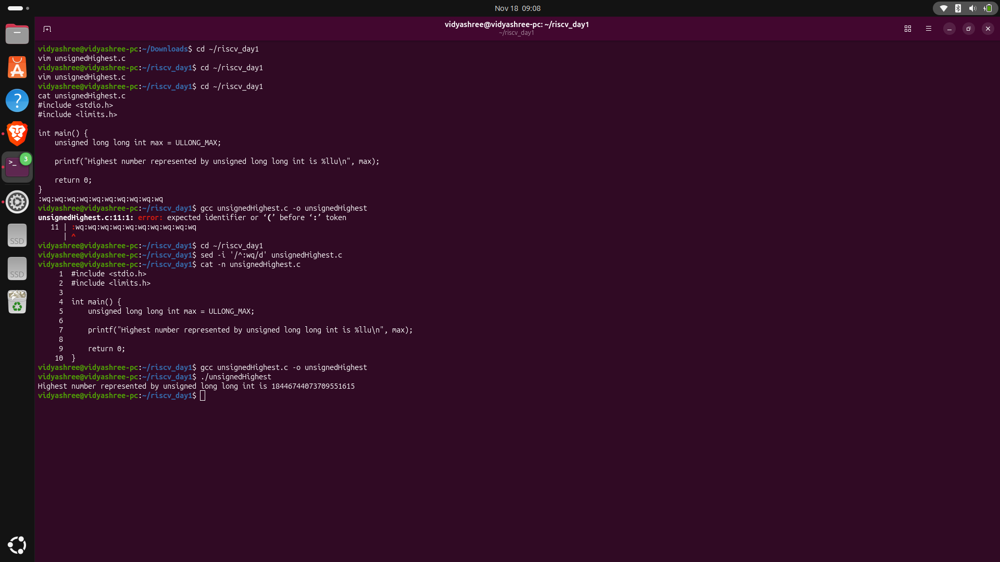
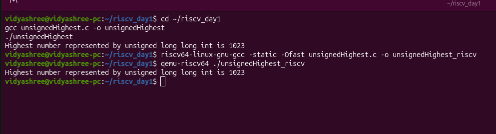
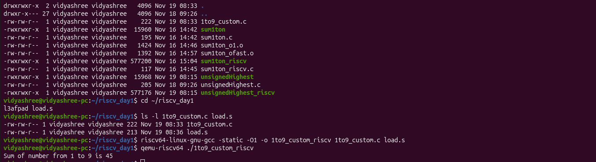
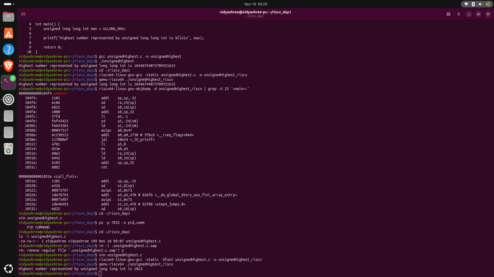
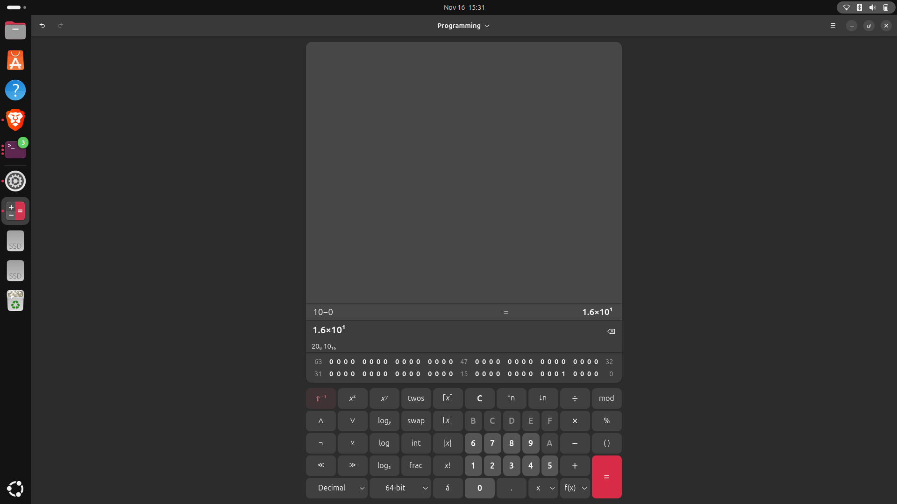
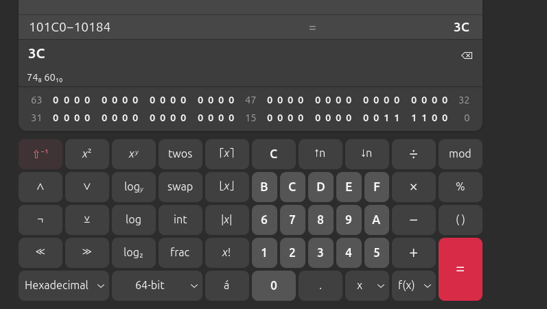
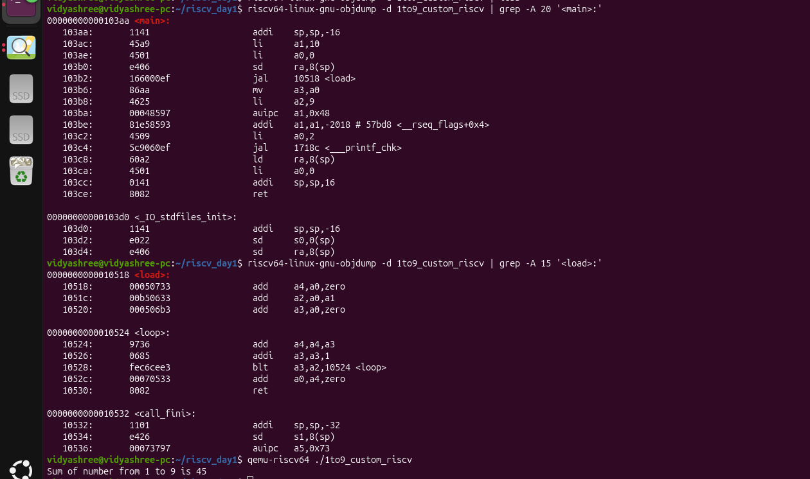
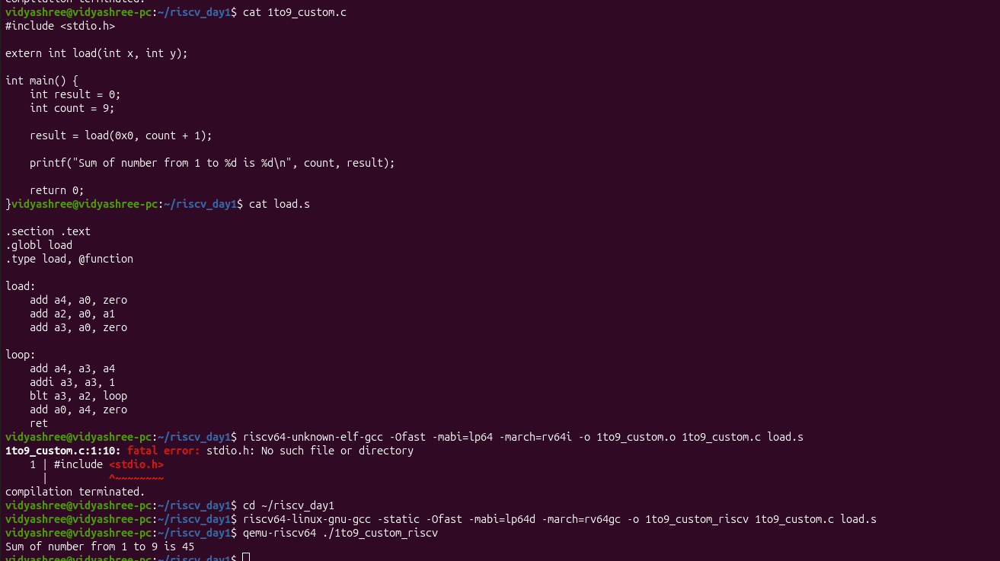
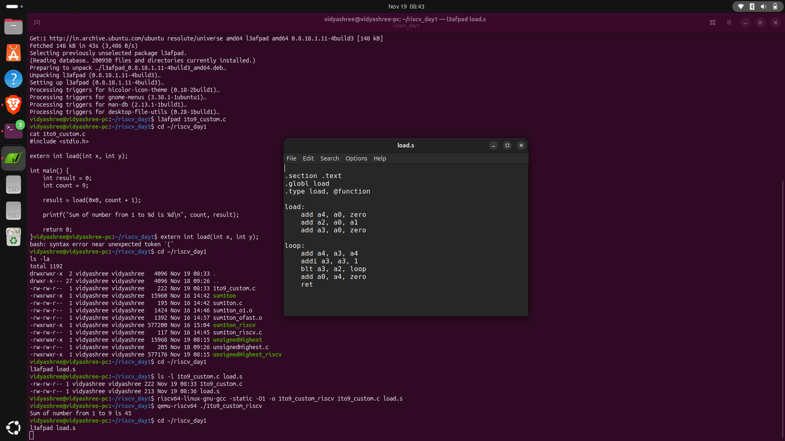

# Day 1 — RISC-V ISA, C Toolchain, and Assembly

> **Practical report | Evidence: 11 screenshots**
>
> **Aim:** Compare native and cross-compiled C execution, inspect RISC-V machine code, implement a simple sum using assembly, and practice address arithmetic.

[← Workshop overview](../README.md) · [Browse original screenshots](Screenshots/)

## 1. Overview

We worked on Ubuntu in `~/riscv_day1`. Native `gcc` produced host executables, while `riscv64-linux-gnu-gcc` created RISC-V executables that were run with `qemu-riscv64`. We also inspected disassembly with `riscv64-linux-gnu-objdump` and connected a C program to a RISC-V assembly function.

### Main outcomes
- Printed the maximum value of an unsigned 64-bit integer: **18,446,744,073,709,551,615** in an earlier version of the program.
- Ran a modified **10-bit maximum** exercise, yielding **1023**, both natively and in RISC-V QEMU.
- Executed a C/assembly program to calculate **1 + 2 + … + 9 = 45**.
- Viewed instruction addresses, registers, branching, and call sites in the compiled RISC-V assembly.

**Important source-version note:** The checked-in [`unsignedHighest.c`](unsignedHighest.c) currently uses `(1ULL << 10) - 1`, so **it prints 1023**. The earlier screenshot showing `ULLONG_MAX` documents a previous version; it is *not* the output of the file in its current form. The screenshots have been retained as authentic development evidence.

## 2. Screenshot-by-screenshot experiment record

### Screenshot 01 — Unsigned 64-bit maximum: writing and debugging C



**What it shows:** The terminal displays `#include <stdio.h>`, `#include <limits.h>`, and `unsigned long long int max = ULLONG_MAX;`. An early compile failed because Vim `:wq` command text was inadvertently inserted into the C file. The unwanted text was removed, and `gcc` then compiled and ran the program.

**Observed result:** `Highest number represented by unsigned long long int is 18446744073709551615`.

**What we learned:** C macros in `limits.h` provide type limits; a compiler error can be resolved by inspecting and correcting the source rather than changing the toolchain.

### Screenshot 02 — Cross-compile and run the 1023 version using QEMU



**What it shows:** `gcc unsignedHighest.c -o unsignedHighest` is used for native compilation, followed by a RISC-V build using `riscv64-linux-gnu-gcc -static -Ofast unsignedHighest.c -o unsignedHighest_riscv`. The RISC-V executable is run with `qemu-riscv64`.

**Observed result:** Both runs print **1023**, consistent with the 10-bit expression in the current C source.

**What we learned:** Cross-compilation changes the executable's target architecture, not the calculation's expected result; QEMU allows an Ubuntu host to execute the RISC-V binary.

### Screenshot 03 — Sum of numbers 1 through 9 in RISC-V QEMU



**What it shows:** The `1to9_custom.c` C source and an assembly file named `load.s` are compiled with `riscv64-linux-gnu-gcc -static -O1`. Then the output `1to9_custom_riscv` is executed via QEMU.

**Observed result:** `Sum of number from 1 to 9 is 45`.

**What we learned:** C can invoke a separately defined assembly function and use its return value. The sum agrees with `9 × 10 / 2 = 45`.

### Screenshot 04 — Disassembling the `main` function



**What it shows:** `riscv64-linux-gnu-objdump -d unsignedHighest_riscv | grep -A 25 '<main>:'` displays instruction addresses, machine codes and mnemonics. The screen also captures cleaning up an editor swap file and rerunning the 1023 example.

**What we learned:** Disassembly links high-level C to lower-level instructions such as `addi`, `ld`, `sd`, `jal` and `ret`. The file-cleanup commands are troubleshooting evidence, not part of the program logic.

### Screenshot 05 — Converting decimal 65984 into hexadecimal


**What it shows:** Ubuntu's Programmer Calculator displaying decimal **65984**, which is hexadecimal **0x101C0**.

**What we learned:** Decimal/hex conversion helps when studying `objdump` addresses and memory locations.

### Screenshot 06 — Programmer Calculator exercise



**What it shows:** A calculator expression and its base-converted display. The selected base and scientific-format presentation matter when interpreting the result.

**What we learned:** Always check the calculator's input base before treating displayed digits as decimal. This image is supporting address-arithmetic practice, not evidence of program execution.

### Screenshot 07 — Hexadecimal address subtraction



**What it shows:** Hexadecimal subtraction `0x101C0 - 0x10184 = 0x3C`.

**Observed result:** `0x3C = 60` bytes (decimal).

**What we learned:** Subtracting hexadecimal addresses finds the byte difference between locations. It should not automatically be interpreted as the number of instructions, since RISC-V instructions can have different widths.

### Screenshot 08 — Additional capture of the C debugging process


**What it shows:** Another capture of the `ULLONG_MAX` compilation issue and correction, ending in the maximum unsigned value.

**Why included:** It preserves additional terminal context for the debugging sequence. It supports the same earlier-version experiment as Screenshot 01.

### Screenshot 09 — Disassembling both C entry point and assembly routine



**What it shows:** `objdump` filters for `<main>:` and `<load>:` in the sum program. The listing includes the function call from `main` to `load`, arithmetic operations, and a branch back to the loop.

**What we learned:** The program can be inspected at both the C-calling-function level and the hand-written assembly routine. The loop uses register arithmetic and a conditional branch to accumulate the sum.

### Screenshot 10 — Mixed-language source files and a toolchain correction



**What it shows:** `cat 1to9_custom.c` and `cat load.s` print the source. The C code declares `extern int load(int x, int y);`, and the assembly implements a loop. An attempted build with a different cross-compiler reports missing `stdio.h`; switching to `riscv64-linux-gnu-gcc` succeeds.

**Observed result:** `Sum of number from 1 to 9 is 45`.

**What we learned:** Toolchains may differ in installed C-library headers and targets. The working compiler was appropriate for the Linux/QEMU experiment.

### Screenshot 11 — Editing the RISC-V `load.s` routine



**What it shows:** The `load.s` source open in an editor, with `.section .text`, `.globl load`, `load:`, and `loop:` labels. The screenshot also shows the terminal build and QEMU output for the sum of 1 through 9.

**What we learned:** A labeled assembly function can use `add`, `addi`, `blt` and `ret` to implement iterative addition and return a result to C.

## 3. Reproducing the recorded work

The following commands apply to the **source files currently included** in this repository.

```bash
cd Day1_RISCV_ISA
gcc unsignedHighest.c -o unsignedHighest
./unsignedHighest

riscv64-linux-gnu-gcc -static unsignedHighest.c -o unsignedHighest_riscv
qemu-riscv64 ./unsignedHighest_riscv
riscv64-linux-gnu-objdump -d unsignedHighest_riscv | grep -A 25 '<main>:'
```

For the assembly sum exercise, the captured build used `load.s`. That file is **visible in the screenshots but is not currently checked into Day 1**; add the original source before claiming the example is fully reproducible from this folder.

## 4. Conclusion

Day 1 connected C source code, RISC-V cross-compilation, emulated execution, machine-level disassembly, assembly functions and address calculations. The screenshots document both correct outputs and the practical debugging steps required to reach them.

**Next:** [Day 2 — PicoRV32 simulation](../Day2_PicoRV32/README.md)
