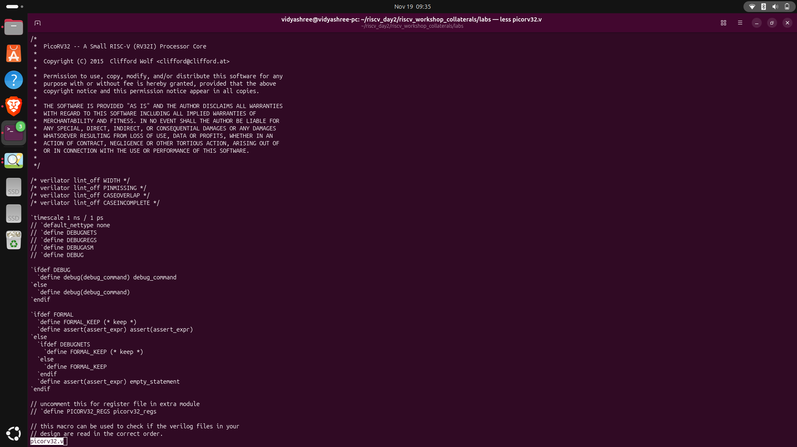
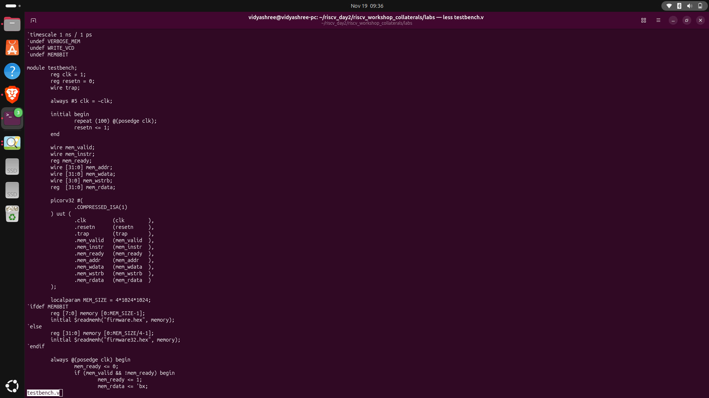
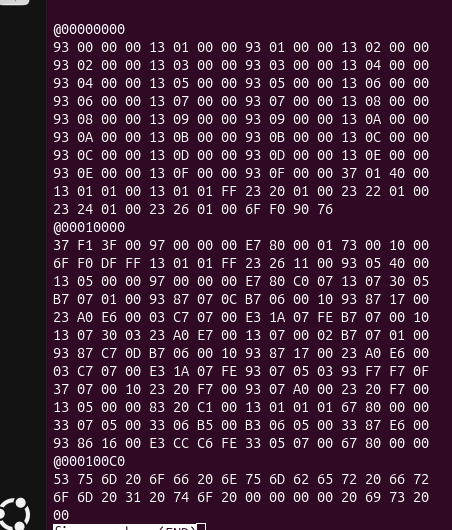
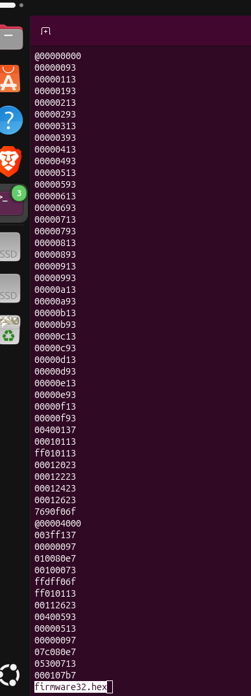
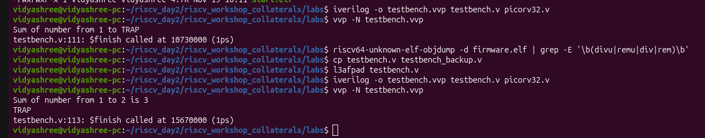
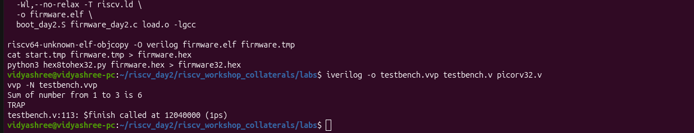

# Day 2 — PicoRV32 Processor Simulation

> **Practical report | Evidence: 6 screenshots**
>
> **Aim:** Build RV32IM firmware, load it into a PicoRV32 Verilog testbench, and verify execution using Icarus Verilog and VVP.

[← Workshop overview](../README.md) · [Browse screenshots](Screenshots/) · [Day 1 report](../Day1_RISCV_ISA/README.md)

## 1. Overview

Day 2 moved from command-line RISC-V execution to running a program on a simulated **PicoRV32** processor. The project included Verilog core and testbench files, a startup routine, freestanding C firmware, RISC-V assembly, linker scripts, and tools to generate memory initialization files.

The captured experiments include two successfully completed sums: **1 through 2 = 3** and **1 through 3 = 6**.

## 2. Screenshot-by-screenshot record

### Screenshot 01 — Inspecting the PicoRV32 processor RTL



**What it shows:** The `picorv32.v` file viewed with `less`. Its header identifies *PicoRV32 — A Small RISC-V (RV32I) Processor Core* and includes Clifford Wolf's copyright and permission notice. The screenshot also shows Verilog directives and configuration definitions.

**Why it matters:** The core implements the processor hardware modeled in the simulation. **RV32I** describes the base integer instruction set; the testbench additionally enables multiplication and division support.

**Observation:** This proves the source file was inspected, not that the core was designed from scratch. The upstream copyright notice must be preserved.

### Screenshot 02 — Examining the Verilog testbench



**What it shows:** The `testbench.v` source defines a clock, reset, the processor instance (`picorv32`), and memory wiring including `mem_valid`, `mem_ready`, address, read data and write data. It uses `$readmemh` to initialize simulated memory.

**Why it matters:** A testbench supplies the processor clock/reset and models the external memory and output environment, allowing processor instructions to be fetched and executed.

**Observation:** The testbench can load either byte-oriented `firmware.hex` or 32-bit-oriented `firmware32.hex`, depending on the `MEM8BIT` conditional configuration.

### Screenshot 03 — Inspecting the byte-oriented firmware HEX



**What it shows:** The memory initialization file `firmware.hex` containing address markers such as `@00000000` and groups of hexadecimal bytes.

**Why it matters:** A compiled ELF must be converted into a representation the Verilog memory model can read. The `@...` markers specify memory initialization addresses in the Verilog HEX format.

**Observation:** These are encoded firmware bytes, not a terminal execution trace or numerical calculation results.

### Screenshot 04 — Inspecting the 32-bit firmware memory image



**What it shows:** `firmware32.hex` with 8-digit hexadecimal words and memory address markers.

**Why it matters:** The 32-bit memory array in `testbench.v` uses `$readmemh("firmware32.hex", memory)`. Reformatting the firmware into 32-bit words lets that memory model access machine instructions and data.

**Observation:** File contents are evidence of firmware image generation; functional correctness must be checked using the simulation output.

### Screenshot 05 — Simulating a sum of 1 through 2



**What it shows:** The testbench is compiled using `iverilog -o testbench.vvp testbench.v picorv32.v` and executed using `vvp -N testbench.vvp`. The terminal includes an earlier incomplete printout and a subsequent corrected run.

**Observed result:** `Sum of number from 1 to 2 is 3`, followed by `TRAP`.

**Interpretation:** The completed arithmetic message verifies the intended sum for the second run. The earlier incomplete output is debugging evidence, not a valid sum.

### Screenshot 06 — Simulating a sum of 1 through 3



**What it shows:** Firmware conversion commands using `riscv64-unknown-elf-objcopy`, concatenation of startup and firmware memory dumps, and `python3 hex8tohex32.py`. The Verilog testbench is then built and executed.

**Observed result:** `Sum of number from 1 to 3 is 6`, followed by `TRAP`.

**Interpretation:** The printed output matches the expected arithmetic result. In this setup, `TRAP` follows the firmware termination sequence; it should not be described as an automatic pass indicator independently of the visible output.

## 3. Build and run workflow

The local experiment used a freestanding startup and firmware build to avoid missing standard C headers in the alternate embedded toolchain.

```bash
# From the folder containing all Day 2 source files:
riscv64-unknown-elf-gcc -march=rv32im -mabi=ilp32 -O1 \
  -ffreestanding -nostdlib -nostartfiles -Wl,--no-relax \
  -T riscv.ld -o firmware.elf boot_day2.S firmware_day2.c load.o -lgcc

riscv64-unknown-elf-gcc -march=rv32im -mabi=ilp32 \
  -nostdlib -nostartfiles -o start.elf start.S -T start.ld

riscv64-unknown-elf-objcopy -O verilog start.elf start.tmp
riscv64-unknown-elf-objcopy -O verilog firmware.elf firmware.tmp
cat start.tmp firmware.tmp > firmware.hex
python3 hex8tohex32.py firmware.hex > firmware32.hex

iverilog -o testbench.vvp testbench.v picorv32.v
vvp -N testbench.vvp
```

**Prerequisite:** The `load.o` object in the first command must first be assembled for RV32IM from `load.S` (for example, using `riscv64-unknown-elf-gcc -march=rv32im -mabi=ilp32 -c load.S -o load.o`). A compatible RISC-V GCC, binutils, Python and Icarus Verilog installation are required. The commands describe the tested local workflow, not a universal turnkey build for every platform.

### Source files and their roles

| File | Role |
|---|---|
| [`boot_day2.S`](boot_day2.S) | Sets stack pointer, calls `main`, then enters a stop sequence |
| [`firmware_day2.c`](firmware_day2.c) | Calls the assembly sum routine and outputs text using a memory-mapped output address |
| [`load.S`](load.S) | Implements the assembly summation function |
| [`picorv32.v`](picorv32.v) | Third-party PicoRV32 processor RTL |
| [`testbench.v`](testbench.v) | Provides clock/reset, memory model, and output path |
| [`riscv.ld`](riscv.ld), [`start.ld`](start.ld) | Define address layout for linking |
| [`hex8tohex32.py`](hex8tohex32.py) | Converts memory data representation for the Verilog testbench |

The [checked-in `firmware_day2.c`](firmware_day2.c) sets `count = 3`, corresponding to the final **sum = 6** simulation. The screenshot showing **sum = 3** records an earlier parameter setting, not the current source's output.

## 4. Results and learning outcomes

| Test | Expected | Recorded |
|---|---:|---:|
| Sum 1 + 2 | 3 | 3 |
| Sum 1 + 2 + 3 | 6 | 6 |

Day 2 demonstrated the path from C and assembly to RISC-V machine code, Verilog memory images, processor simulation and terminal output. It also showed why compiler environments, memory formatting and debugging are important.

**Attribution:** PicoRV32 is a third-party project by Clifford Wolf. Retain upstream notices. Workshop collateral: [kunalg123/riscv_workshop_collaterals](https://github.com/kunalg123/riscv_workshop_collaterals).

**Next:** [Day 3 — TL-Verilog in Makerchip](../Day3_TL_Verilog/README.md)
