# Day 3 — TL-Verilog Digital Logic in Makerchip

> **Practical report | Evidence: 13 screenshots**
>
> **Aim:** Learn TL-Verilog signal definitions, combinational logic, sequential delays, pipelining, feedback, arithmetic and a simple ALU through Makerchip circuit diagrams and waveforms.

[← Workshop overview](../README.md) · [Browse screenshots](Screenshots/) · [Day 2 report](../Day2_PicoRV32/README.md)

## 1. Overview

Day 3 used the [Makerchip IDE](https://myth.makerchip.com/ide/) to write **TL-Verilog (TLV)** examples and inspect generated logic diagrams and simulated waveforms. The repository contains seven illustrative `.tlv` sources in addition to the screenshots. These activities are *introductory hardware building blocks*, **not** a complete RISC-V processor implementation.

The example code uses `$signal` for TLV signals and `>>1$signal` to refer to a value from one cycle earlier. A simulation completion condition such as `*passed = *cyc_cnt > 40` controls the Makerchip test session; it is **not** a comprehensive correctness assertion for the logic itself. Correctness is evaluated by inspecting signal values.

## 2. Screenshot-by-screenshot explanation

### Screenshot 01 — Logic gates: graphical connectivity

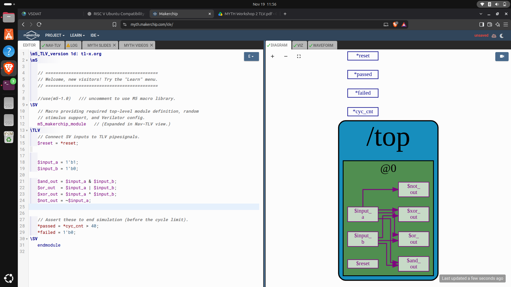

**What it shows:** A Makerchip schematic-style visualization of `$input_a` and `$input_b` feeding four output signals: `$and_out`, `$or_out`, `$xor_out`, and `$not_out`. The code uses the TL-Verilog operators `&`, `|`, `^` and `~`.

**What it means:** This is an RTL dependency/connection diagram. It shows which inputs influence each logic output; it is not a transistor-level schematic.

### Screenshot 02 — Truth-table validation in the waveform

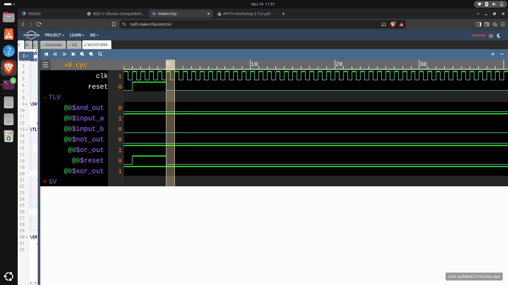

**What it shows:** The waveform for inputs `a = 1`, `b = 0`, and the resulting logic outputs.

**Observed values:** AND = **0**, OR = **1**, XOR = **1**, NOT A = **0**.

**What we learned:** Waveforms make it possible to check the output of each Boolean function against its truth table.

### Screenshot 03 — First AND-gate connection diagram

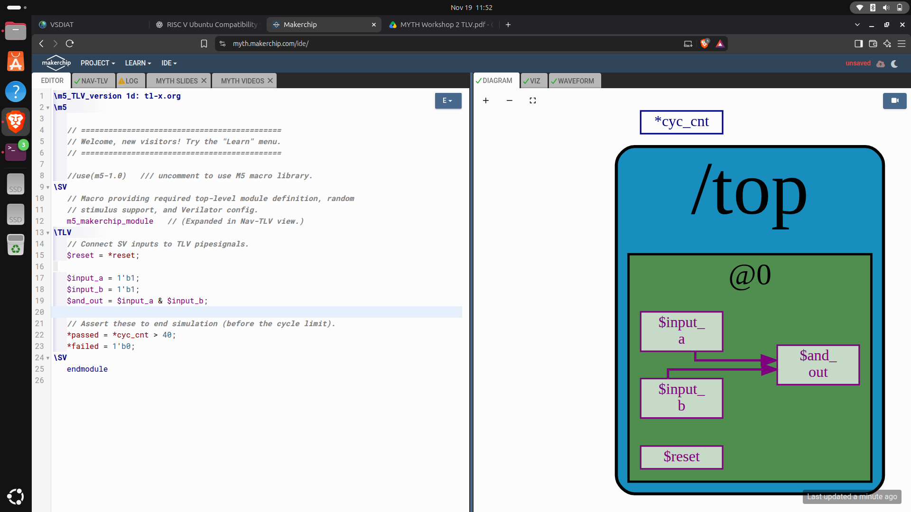

**What it shows:** A simpler early circuit with `$input_a = 1'b1`, `$input_b = 1'b1`, and `$and_out = $input_a & $input_b`. Makerchip draws connections between the inputs and output.

**Observed result:** For inputs 1 and 1, AND is 1.

**What we learned:** A simple AND gate can be expressed directly as a combinational TLV assignment.

### Screenshot 04 — Compilation log and tool feedback

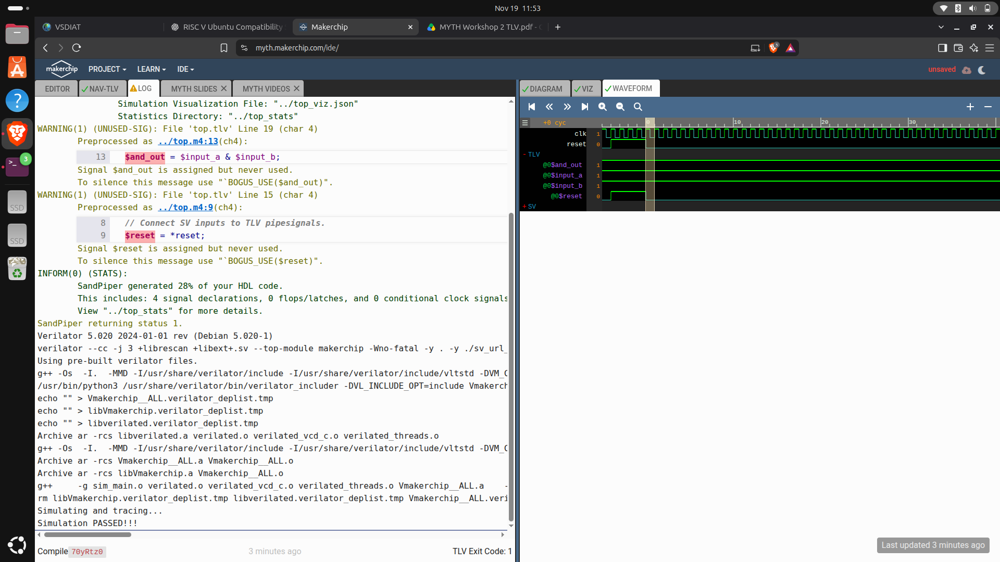

**What it shows:** Makerchip's log after generating HDL and running the simulation. It includes unused-signal warnings for `$and_out` and `$reset` in an early example, followed by the message **`Simulation PASSED!!!`**.

**What we learned:** Nonfatal warnings and successful simulation execution can appear together. The log confirms the tool ran, while the signal waveforms are still needed to check functional behavior.

### Screenshot 05 — 2-to-1 multiplexer waveform

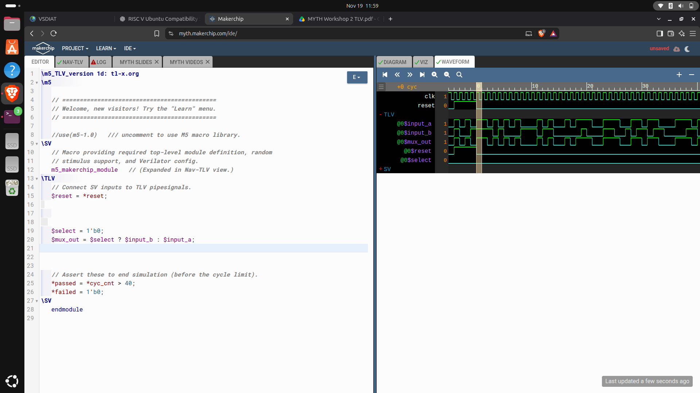

**What it shows:** Two data inputs, select and output signals in the waveform, with the selection expression `$mux_out = $select ? $input_b : $input_a;`.

**Interpretation:** When select = 0, output follows input A; when select = 1, it follows input B. The screenshot shows the select fixed at 0 while the data input signals vary.

**What we learned:** Conditional operators implement selection logic in RTL.

### Screenshot 06 — Single-cycle sequential register

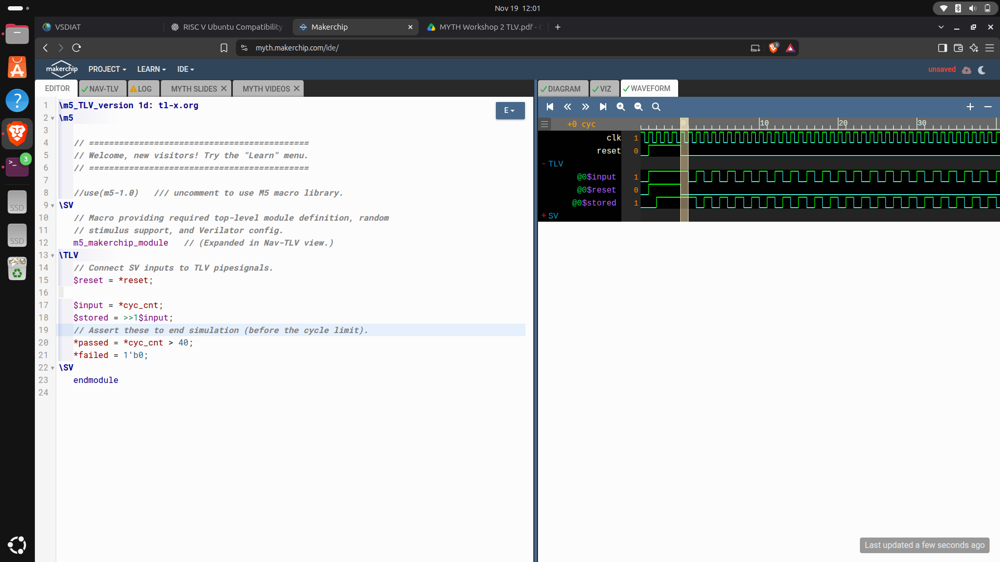

**What it shows:** The statements `$input = *cyc_cnt;` and `$stored = >>1$input;` with input and stored waveforms.

**What it means:** `>>1` references the preceding cycle's signal value. The output is a one-cycle delayed version of the input.

**What we learned:** Register delay in TL-Verilog can be represented explicitly in a time-shift expression.

### Screenshot 07 — Three-stage pipeline

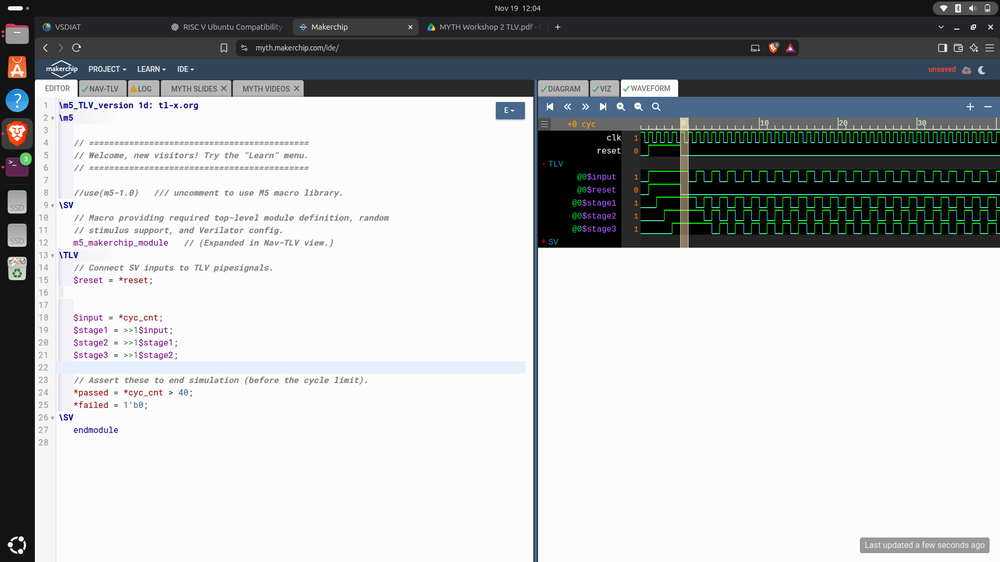

**What it shows:** Cascaded assignments `$stage1 = >>1$input`, `$stage2 = >>1$stage1`, and `$stage3 = >>1$stage2` with waveforms of all pipeline stages.

**What it means:** Each stage adds a one-cycle delay, so stage 3 is three cycles behind the original input.

**What we learned:** Pipelining separates values across clock cycles and introduces latency.

### Screenshot 08 — Four-bit counter using feedback

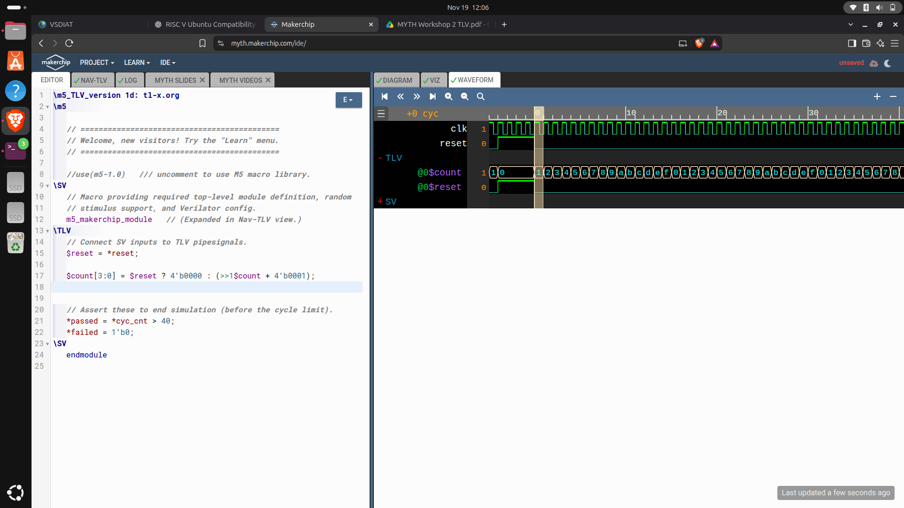

**What it shows:** A 4-bit counter updated using `$count[3:0] = $reset ? 4'b0000 : (>>1$count + 4'b0001);` and a waveform displaying values from hexadecimal 0 through F.

**Observed result:** The count increments modulo 16, wrapping from F to 0.

**What we learned:** State feedback and a one-cycle delayed value can implement a sequential counter.

### Screenshot 09 — Adder and subtractor results

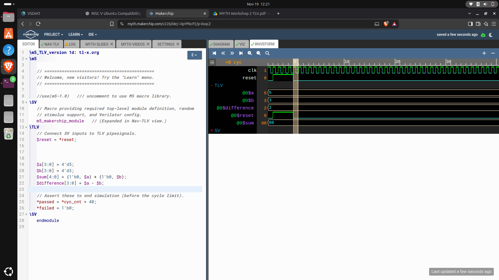

**What it shows:** Two 4-bit constants, `$a = 5` and `$b = 3`, being used in both addition and subtraction. The addition is widened to 5 bits with a leading zero to retain a carry-out when needed.

**Observed results:** Sum = **8**; difference = **2**.

**What we learned:** Operand widths matter in hardware arithmetic; widening inputs makes the intended result width explicit.

### Screenshot 10 — ALU addition (opcode 00)

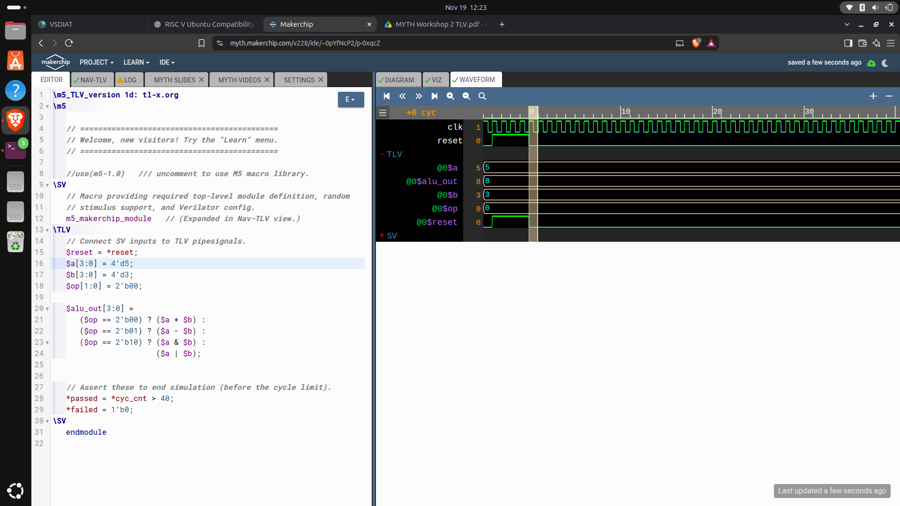

**What it shows:** A simple four-function ALU selected by a 2-bit `$op`. With `$op = 2'b00`, `a = 5`, and `b = 3`, its `$alu_out` is **8**.

**Interpretation:** This verifies the addition branch of the conditional-expression ALU.

### Screenshot 11 — ALU subtraction (opcode 01)

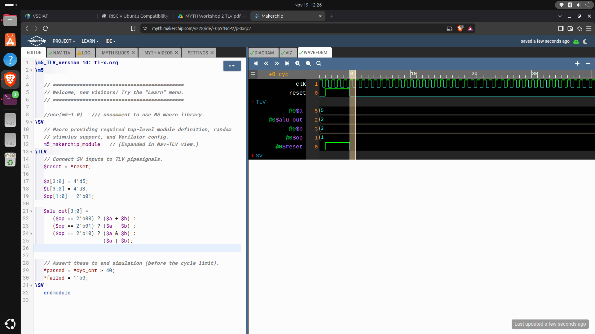

**What it shows:** The same ALU with `$op = 2'b01`, producing `5 - 3`.

**Observed result:** `$alu_out = 2`.

**Interpretation:** The subtraction selection is working for the shown inputs.

### Screenshot 12 — ALU bitwise AND (opcode 10)

**What it shows:** `$op = 2'b10` selects the bitwise AND operation.

**Observed result:** `5 & 3 = 1` because `0101 & 0011 = 0001`.

**Interpretation:** The ALU performs bitwise operations, not only arithmetic.

### Screenshot 13 — ALU bitwise OR (opcode 11)

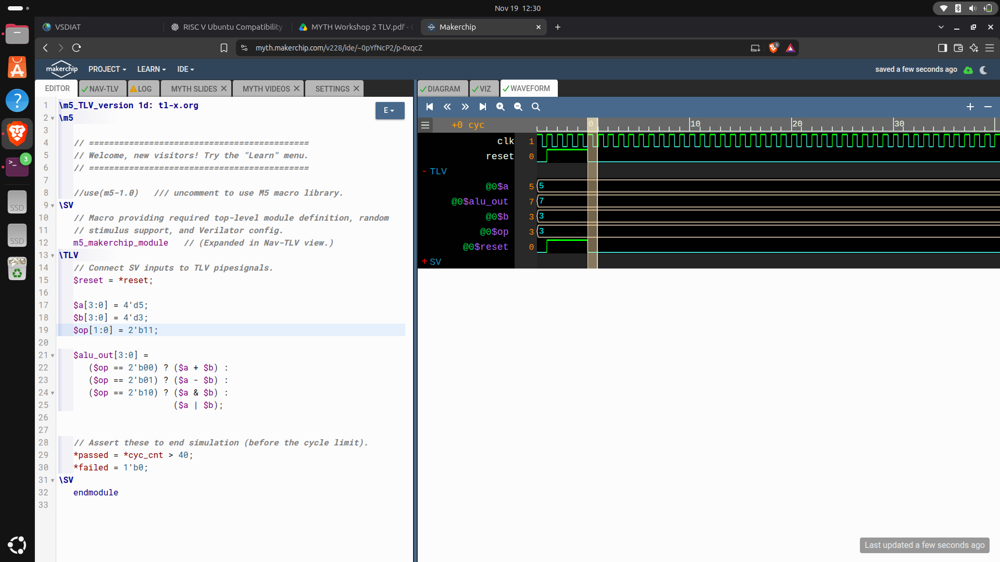

**What it shows:** `$op = 2'b11` selects the bitwise OR operation.

**Observed result:** `5 | 3 = 7` because `0101 | 0011 = 0111`.

**Interpretation:** The final ALU selection case matches the expected output.

## 3. Source index

| Source file | Purpose |
|---|---|
| [`01_logic_gates.tlv`](01_logic_gates.tlv) | AND, OR, XOR and NOT |
| [`02_mux_2to1.tlv`](02_mux_2to1.tlv) | Conditional 2:1 selection |
| [`03_sequential_register.tlv`](03_sequential_register.tlv) | One-cycle delay |
| [`04_three_stage_pipeline.tlv`](04_three_stage_pipeline.tlv) | Three cascaded cycle delays |
| [`05_four_bit_counter.tlv`](05_four_bit_counter.tlv) | Resettable 4-bit feedback counter |
| [`06_adder_subtractor.tlv`](06_adder_subtractor.tlv) | Addition and subtraction |
| [`07_simple_alu.tlv`](07_simple_alu.tlv) | ADD, SUB, AND and OR operations |

The screenshots show specific test configurations used during practice. Some checked-in source files initialize different constant values (for example, opcode 11 in the ALU file), so **each screenshot documents the test setting visible in that screenshot**, not necessarily the default setting in every source file.

## 4. ALU verification table

For `a = 5`, `b = 3`:

| Select (`op`) | Operation | Expected | Observed |
|---|---|---:|---:|
| `00` | ADD | 8 | 8 |
| `01` | SUB | 2 | 2 |
| `10` | AND | 1 | 1 |
| `11` | OR | 7 | 7 |

## 5. Conclusion

This day introduced the RTL concepts needed before tackling a pipelined CPU: combinational logic, signal selection, registers, feedback, multistage pipelines and a basic ALU. The screenshots demonstrate the actual IDE code, generated diagrams and waveforms for each exercise. A complete instruction-decoding RISC-V CPU was **not** implemented in this set of examples.

**Workshop complete:** [Return to the three-day overview](../README.md)
