# Day 4 — RISC-V CPU Design with TL-Verilog (Makerchip)

**Workshop:** RISC-V MYTH • **Evidence:** 15 screenshots • **Environment:** Makerchip / TL-Verilog

[← Main repository](../README.md) · [Open Makerchip IDE](https://myth.makerchip.com/ide/)

## Objective

Build up a simple educational RISC-V CPU from the MYTH workshop shell. The work progresses from program-counter and instruction-memory access through instruction decoding, immediate extraction, register-file access, ADD/ADDI execution, branch control and verification of the sum-of-1-to-9 test program.

**Result observed:** The simulation waveform shows the accumulated sum **45 decimal = `0x0000002D`** in register **x14**, and the same value written to **x10 (a0)** briefly. The final register value subsequently returns to zero because execution continues; program completion/halting is **not implemented or independently verified**. The workshop's `Simulation PASSED!!!` message alone reflects a cycle-count completion condition, not an end-to-end functional assertion.

## Illustrated practical record

Each screenshot is listed in the user's original order. The screenshots have intentionally simple, ordered filenames so GitHub can display this document as a readable illustrated lab report.

### 01. Starter CPU shell and assembly program

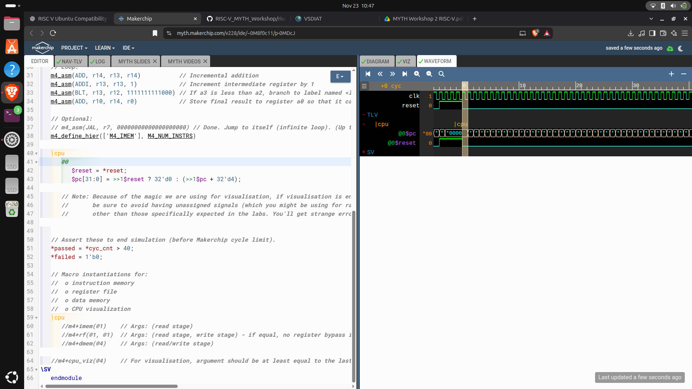

**Observation:** The starting TL-Verilog shell contains an assembly test program for summing 1 through 9, a `|cpu` pipeline, reset logic and commented macro calls. This is the baseline, not a fully functioning CPU.

### 02. Instruction-memory macro enabled

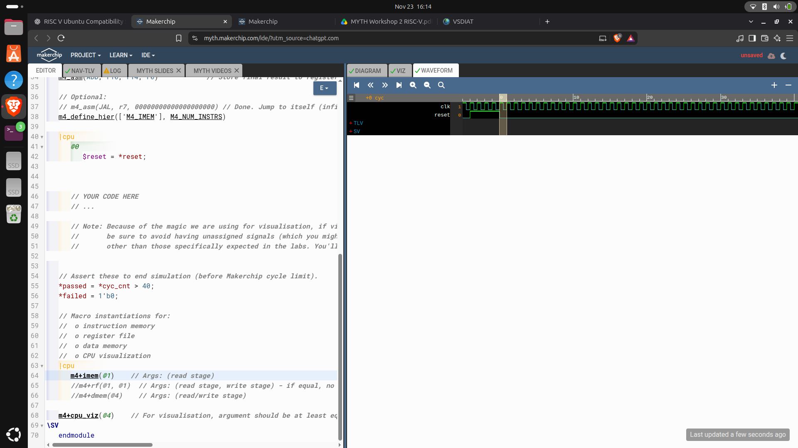

**Observation:** The instruction-memory macro `m4+imem(@1)` is enabled in the lower macro section. At this stage the editor is still close to the starter shell; the image verifies the module setup rather than program execution.

### 03. Program counter and initial instruction fetch

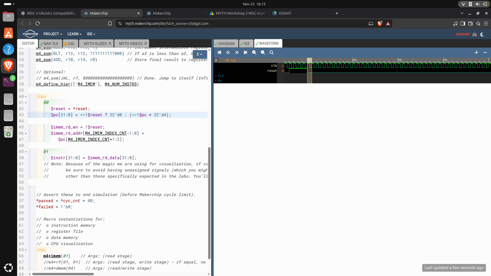

**Observation:** The stage `@0` PC begins advancing by four bytes; instruction-memory read enable/address signals are introduced, with fetched instructions registered at `@1`. Waveforms are not yet proof of the correct sum.

### 04. Opcode and instruction-format classification

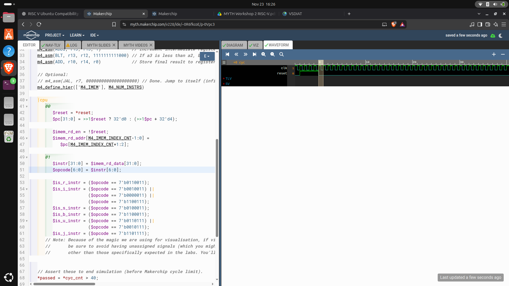

**Observation:** The fetched instruction is split into opcode and instruction formats (R, I, S, B, U and J). The screenshot shows code construction and the Makerchip workspace during this incremental step.

### 05. Immediate generation and instruction-field extraction

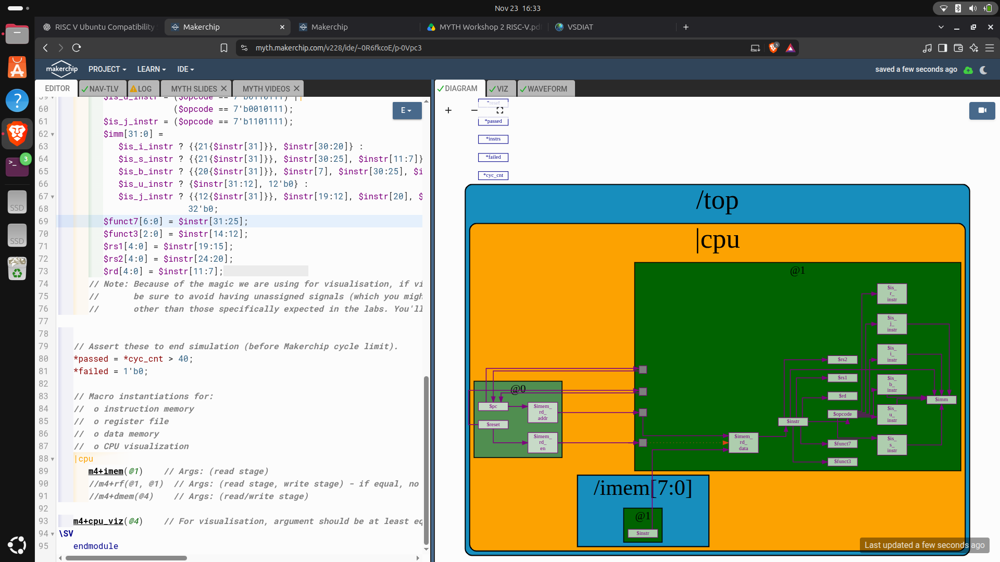

**Observation:** The design extracts sign-extended immediates for multiple instruction formats and the `funct7`, `funct3`, `rs1`, `rs2` and `rd` fields. The diagram displays the instruction-memory-to-decoder connections.

### 06. Register-field validity signals

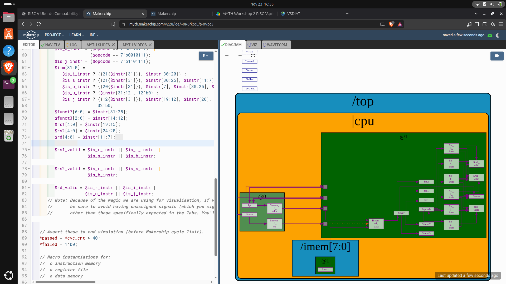

**Observation:** The `rs1_valid`, `rs2_valid` and `rd_valid` flags indicate which instruction classes read or write registers. The diagram shows these new control signals connected to the instruction decoder.

### 07. Individual instruction decode

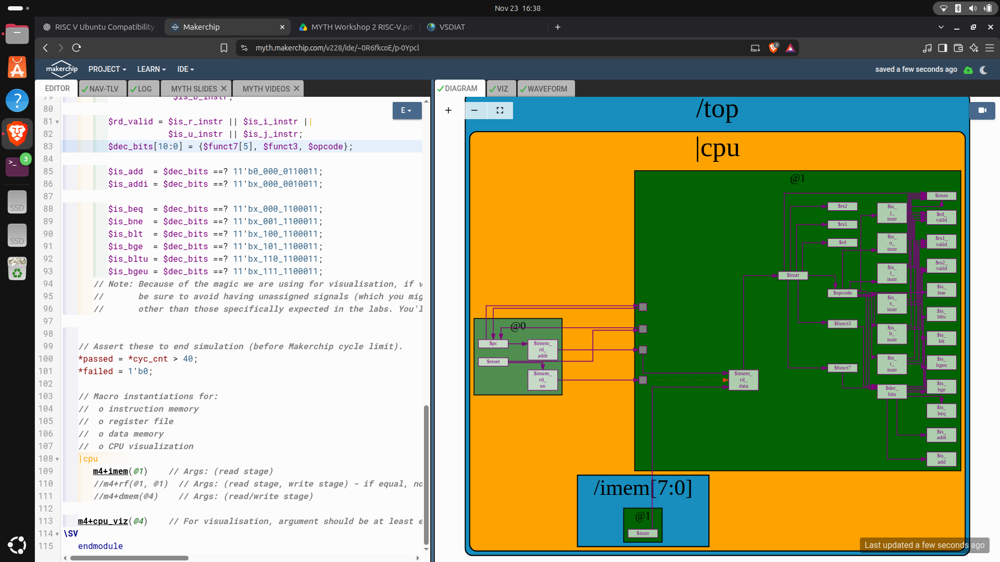

**Observation:** Specific ADD, ADDI, BEQ, BNE, BLT, BGE, BLTU and BGEU instructions are distinguished using opcode/function bits. These decode signals will drive arithmetic and control flow.

### 08. Register-file read interface

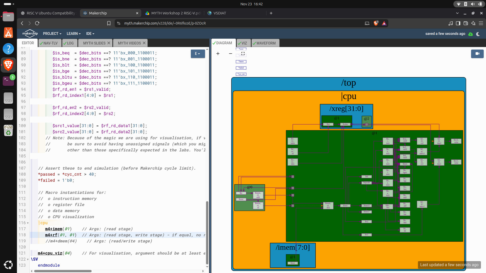

**Observation:** The `m4+rf(@1, @1)` macro is enabled, exposing the `/xreg[31:0]` register bank. Read enables, indices and data outputs are connected to source operand signals.

### 09. ADD and ADDI arithmetic result

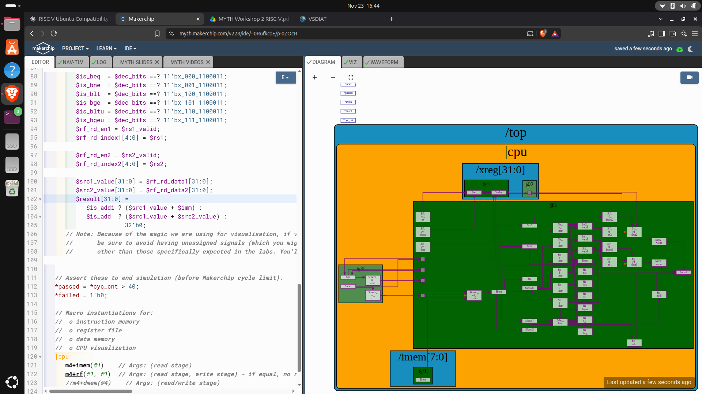

**Observation:** `$result` selects the sum of two register operands for ADD or the sum of an operand and immediate for ADDI. The CPU diagram includes a new result path; this is a partial ALU for the workshop program.

### 10. Register-file write-back

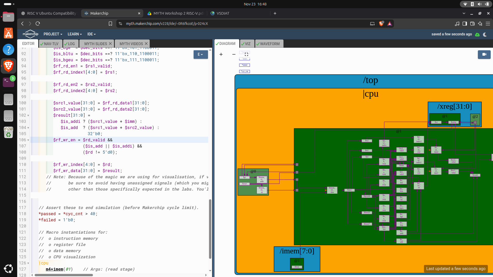

**Observation:** Write enable, destination index and write data are attached to the register file. Writes are limited to implemented ADD/ADDI operations and destination x0 is excluded.

### 11. Branch decision and branch target

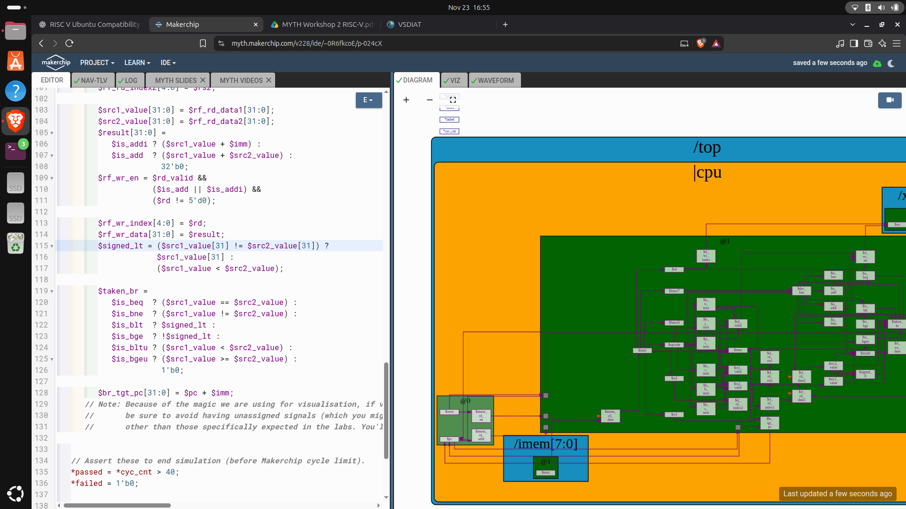

**Observation:** The design compares source operands for equal/unequal and signed/unsigned branches, then calculates a candidate target using PC plus branch offset. The screenshot reflects the iterative construction of branch logic.

### 12. PC selection with branch feedback

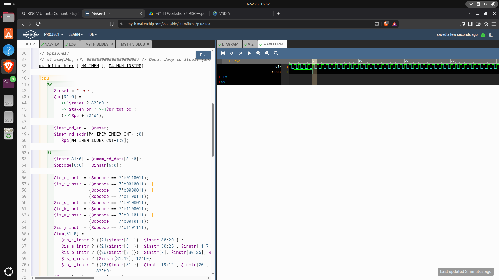

**Observation:** The PC is updated to choose reset, branch target or sequential `PC+4`, introducing a branch feedback path. This allows the loop's BLT instruction to revisit earlier instructions.

### 13. Instruction and branch waveforms

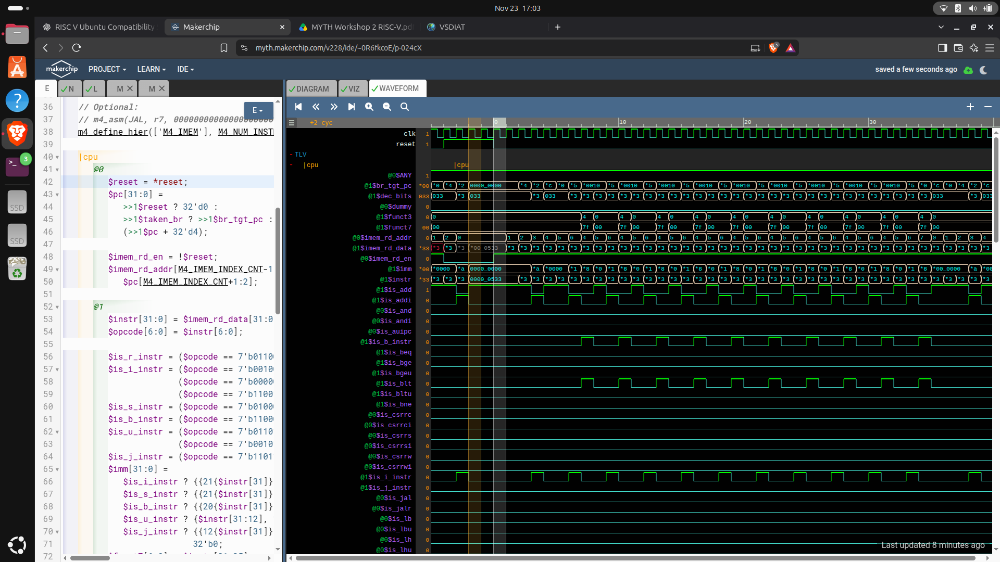

**Observation:** Makerchip waveforms show instruction fetch, opcode decode, PC changes and recurring BLT/branch activity during the loop. This captures control flow in simulation.

### 14. Register write-back waveforms

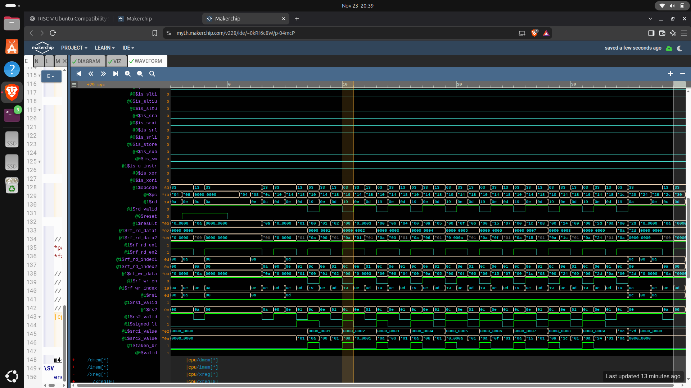

**Observation:** Waveforms show ALU results, register indices, register-file write enable and data. Near the end, destination index `0x0A` and write data `0x0000002D` are observed, evidencing the result transfer to x10.

### 15. Register bank and final result

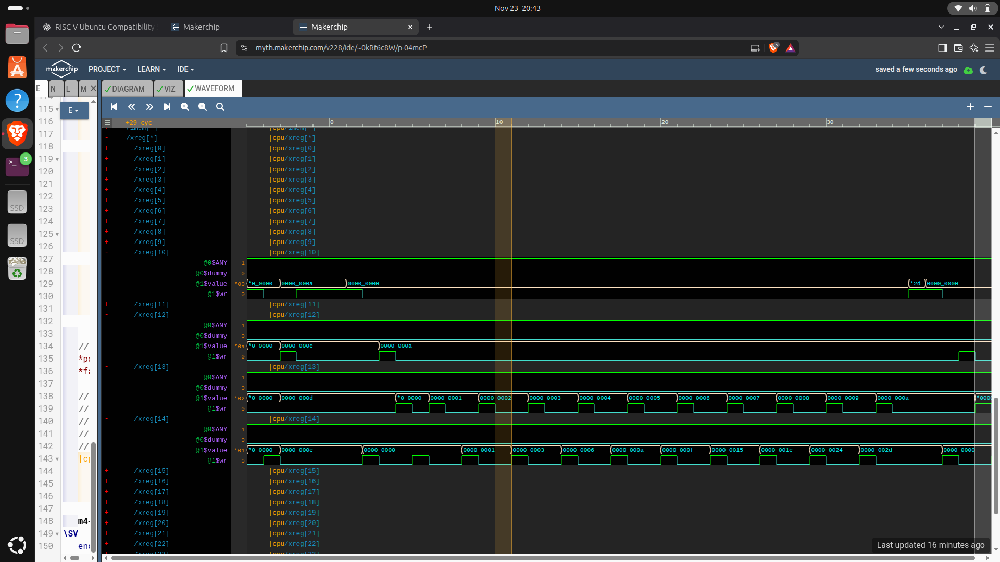

**Observation:** Expanded `/xreg[10]`, `/xreg[12]`, `/xreg[13]` and `/xreg[14]` waveforms are inspected. The accumulator reaches `0x2D` (45), and x10 briefly shows `0x2D`; the result does not remain there for the rest of the shown trace.

## Hardware flow

```text
Program counter (@0)
       |
       v
Instruction memory (m4+imem)
       |
       v
Instruction decode (@1) ----> immediate + rs1/rs2/rd + type checks
       |                                     |
       v                                     v
Register file (m4+rf) ------------------> operands
       |                                     |
       +----------> ADD / ADDI --------------+
                         |
                         v
                Destination write-back
                         |
                         v
               x14 accumulator -> x10 output

Branch comparator -> taken_br / branch target -> next PC
```

## Verification summary

| Signal / register | Meaning | Evidence and result |
|---|---|---|
| `$pc` | Program counter | Sequential increments and branch redirection are visible in control waveforms |
| `$instr`, `$opcode` | Fetched instruction/decode | Instruction patterns and ADD/ADDI/BLT activity appear in screenshots 13–14 |
| `x12` | Loop bound | `0x0000000A` = 10 |
| `x13` | Loop counter | Advances through 1 to 10 |
| `x14` | Running sum | 0 → 1 → 3 → 6 → 10 → 15 → 21 → 28 → 36 → **45** |
| `x10 (a0)` | Output register | Briefly receives `0x0000002D` = **45** (screenshot 15) |
| `$rf_wr_index`, `$rf_wr_data` | Destination and data | Target register `0x0A`, data `0x0000002D` observed (screenshot 14) |

### Notes and limitations

- This is an **incremental learning implementation** built around a small test program, not a complete RV32I processor.
- The screenshots are a progression; early screenshots may show incomplete functionality.
- Only the ADD and ADDI ALU operations are implemented in the shown execution path, with branch comparisons added for loop control. Additional decoded instruction categories are not automatically fully implemented.
- The final waveform shows that the result **does not remain latched in x10**. A future iteration should add a proper stop/hold mechanism or terminating program behavior, together with an explicit test for `x10 == 45`.
- The instruction memory, register-file and visualization helpers are provided by upstream MYTH workshop libraries, not authored here. Preserve those projects' licenses and attribution.

## Reproducing and saving the lab

1. Open [Makerchip](https://myth.makerchip.com/ide/), start from the RISC-V MYTH workshop shell, and load the saved Day 4 project.
2. Enable `m4+imem(@1)` and `m4+rf(@1, @1)` at their workshop-defined indentation.
3. Confirm the `@0` PC/fetch and `@1` decode, register, ALU and branch blocks.
4. Compile and inspect **LOG**, **DIAGRAM**, and **WAVEFORM**.
5. Expand `/xreg[10]` and `/xreg[14]` in the waveform. Validate the intermediate sum and the final `0x2D` write.

### Sources / attribution

- [RISC-V MYTH Workshop shell and training material](https://github.com/stevehoover/RISC-V_MYTH_Workshop)
- [Makerchip IDE](https://myth.makerchip.com/ide/)

---
**Next:** Day 5 — CPU pipelining and associated control/data-hazard work (to be documented separately).
